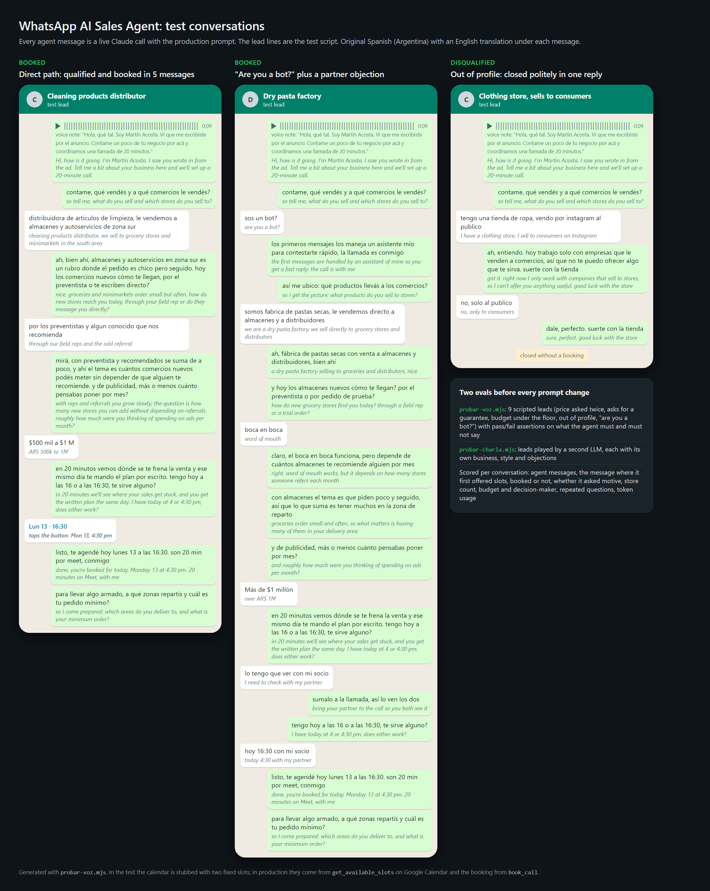
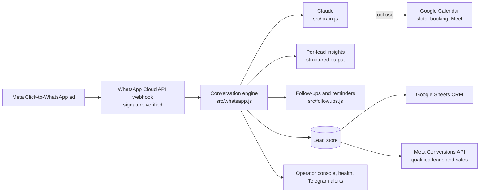

# WhatsApp AI Sales Agent


A production agent that answers every inbound lead from Click-to-WhatsApp ads, qualifies it in a natural conversation and books a sales call on Google Calendar. No human is involved until the call starts.



I built it for the B2B sales line of my growth agency in Argentina, and it runs in production on Railway. The conversations are in Rioplatense Spanish, so the prompts and most identifiers are in Spanish. In this public copy, the persona, the pricing and the case study are placeholders. The logic and the prompt architecture are the production ones.

## What it does

- **Speed to lead.** The first reply goes out in 45 to 120 seconds. An epsilon-greedy bandit A/B tests the opener (voice note or text) and shifts traffic toward the variant that books more calls.
- **Staged discovery.** Claude holds a conversation of 5 to 7 messages, anchored on why the lead wrote in the first place: context, motive, current situation, bridge, ad budget, then scheduling. It asks for the budget before offering times and turns away leads outside the profile politely.
- **Real booking through tool use.** `get_available_slots`, `book_call` and `cancel_booking` check Google Calendar availability across configurable time windows, create the Meet event, and handle reschedules and cancellations.
- **Follow-up engine:**
  - AI-written follow-ups while the 24-hour WhatsApp window is open.
  - Approved Meta templates on days 1, 3 and 7 after it closes.
  - Reminders the day before, 3 hours before and 30 minutes before the call (the last one carries the link).
  - A no-show rescue when the lead misses the call.
- **Per-lead insights.** After each turn, a structured-output call (JSON schema) extracts the lead's writing style, main objection and a 0-100 temperature score. These tune the follow-up cadence and fill the CRM.
- **Voice.** Incoming voice notes are transcribed with Google Speech-to-Text, and the agent can send pre-recorded voice notes.
- **CRM sync.** Each lead gets one row in Google Sheets. Writes match columns by header and never overwrite the columns the sales team adds.
- **Closed-loop attribution.** Qualified leads and declared sales go back to Meta through the Conversions API, so campaigns optimize toward buyers rather than cheap conversations. Phone numbers are normalized to E.164 so the CRM and Meta can be matched. A weekly reconciliation (`reconciliar.mjs`) compares three numbers side by side: the lead registry, the events sent to Meta, and what Meta reports.
- **Operations.** A built-in web console to read chats and take them over, plus health checks and Telegram alerts. An alert that fails can never take the agent down.
- **Guardrails.** Every reply goes through deterministic post-processing, which:
  - strips leaked reasoning and tool syntax,
  - removes banned words,
  - fixes punctuation,
  - caps the turn at three message bubbles.

## Evaluation

Every prompt change goes through two evals before it ships.

- `probar-voz.mjs` runs the production prompt against 9 scripted leads: the direct path, a lead who asks the price twice, a lead burned by curiosity-seekers from past ads, a lead who asks for case studies, a lead who asks for a guarantee, a budget under the floor, an out-of-profile lead, "are you a bot?" with a partner who decides, and a lead who wants to talk to a client first. Each script carries pass/fail assertions on what the agent must and must not say, for example:
  - it gives the fee only when the lead insists,
  - it never invents sales,
  - it never denies being an assistant,
  - it offers a time slot once the lead qualifies.
- `probar-charla.mjs` runs the agent against simulated leads played by an LLM. Each lead has its own business, writing style, urgency and objections. The script scores the flow:
  - how many messages it took to offer a time slot,
  - whether the agent asked about motive, budget and who decides,
  - whether it repeated a question.
- `npm test` runs 53 unit tests covering phone normalization, CRM writes and conversation logic.

## Architecture



## Stack

- Node.js (ESM).
- Anthropic SDK: Claude Haiku with adaptive thinking, prompt caching, tool use and structured output.
- WhatsApp Cloud API, with webhooks checked against X-Hub-Signature-256.
- Google Calendar, Sheets and Speech-to-Text, through a service account.
- Meta Conversions API.
- Railway for hosting.

## Layout

| Path | Role |
|---|---|
| `src/persona.js` | Everything editable: identity, voice, stages, rules, cadence, templates |
| `src/brain.js` | Claude calls, tools, opener generation |
| `src/whatsapp.js` | Webhook, conversation engine, output guardrails, operator console |
| `src/calendar.js` | Free/busy, slot generation, booking |
| `src/followups.js` | Scheduler for follow-ups and reminders |
| `src/insights.js`, `src/bandit.js` | Per-lead analysis, opener A/B test |
| `src/crm.js`, `src/ventas.js` | Google Sheets CRM, declared sales |
| `src/conversiones.js`, `src/cola-conversiones.js` | Meta Conversions API, queue and retries |
| `src/telefono.js` | E.164 normalization (the key that joins CRM and Meta) |
| `probar-charla.mjs` | Simulated-lead evaluation |

## Run it

```bash
npm install
cp .env.example .env   # fill in the keys
npm test
npm start
node probar-charla.mjs # simulated conversations, needs ANTHROPIC_API_KEY
```

Shared for portfolio review. All rights reserved.
